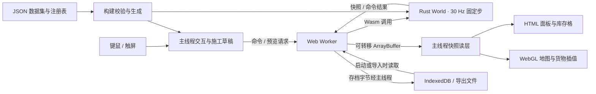

# 《把白昼送回去》软件架构

以 `dev` 的 `95e6d48` 为提交基线，按 2026-11-20 工作区核对。游戏功能与玩法约束见《游戏规格》，本篇记录运行边界、数据流、日常改动入口和扩展成本。[游戏规格](game-spec.md)

## 总体结构

游戏采用**单一权威模拟、命令写入、快照读取**。Rust 的 `World` 持有地图格、设备、库存、运输段、电网、阶段、轨道和蓝图库。模拟运行在一个 Worker 里。浏览器主线程保留镜头、面板、选中项和施工草稿，用模拟快照驱动显示。设备以地图格为主要存储单位，跨格占地另有索引。物流、电力、生产等规则按职责组织，由 `World` 调度。[世界状态](../sim/src/world.rs) · [主线程入口](../src/main.ts) · [Worker](../src/worker.ts)

## 数据流与归属

1. **启动与步进**。前端读取存档，再由 Worker 加载 Wasm，核对内容签名和步频。Worker 累积经过的时间，分配整数个模拟步，调用 `World::step`。模拟先推进班线与输送，并按电网供电结果推进生产和轨道任务。主线程的绘制频率由浏览器调度，货物位置从快照中的起止位置与模拟步数插值。[启动和步进](../src/worker.ts) · [模拟顺序](../sim/src/world.rs) · [绘制入口](../src/main.ts)
2. **操作与交易**。前端把操作编码为 `Op` 和参数，Rust 分派到领域规则后返回结果。以铺带为例，前端按端口与占用规划路径，Rust 提供正式预览。提交时 Rust 再核对布局版本、端口、在途货物和实时库存，然后一次结算施工。这条边界同样保护库存转移，端点身份用于识别设备拆除后同格重建的情况。[命令定义](../src/model.ts) · [Wasm 命令入口](../sim/src/lib.rs) · [铺带校验与结算](../sim/src/construction.rs) · [库存转移](../sim/src/inventory.rs)
3. **模拟到显示**。Rust 将状态写为 `i32` 序列，包含固定的全局头部、全图格记录，以及电网、物品、配方、端口、进度、运输和设备明细等变长段。Worker 从 Wasm 内存复制到可转移的 `ArrayBuffer`，主线程接收后把用完的缓冲交回。读层按当前快照建立设备和货物索引。库存条目由模拟发布数量，界面可以按堆叠上限展开成格，实际存取仍以模拟校验的数量为准。[快照写出](../sim/src/lib.rs) · [设备记录](../sim/src/interface.rs) · [快照读层](../src/sim-data.ts) · [缓冲回收](../src/worker.ts)
4. **计算与渲染分工**。同类型普通带在只有一个入边的连续位置合并为运输段。段内维护可推进时间和货物队列，段之间按端点能力交接。全地图继续模拟，WebGL 只提交镜头范围内的地图实例和货物。设备详情读取同一快照，货物动画沿用模拟给出的轨迹和交接数据。[运输段](../sim/src/belts.rs) · [端点交接](../sim/src/transport.rs) · [视野裁剪与实例化绘制](../src/renderer.ts)

## 模块边界与改动入口

| 改动范围 | 代码归属 | 关系 |
| --- | --- | --- |
| 面板、操作流程、键鼠与触屏 | [main.ts](../src/main.ts) · [input.ts](../src/input.ts) · [inventory-drag.ts](../src/inventory-drag.ts) · [action-hold.ts](../src/action-hold.ts) | `main.ts` 装配 UI 和 Worker，手势绑定把输入交给相同的操作入口。 |
| 地图绘制、端口与路径 | [renderer.ts](../src/renderer.ts) · [icons.ts](../src/icons.ts) · [machine-layout.ts](../src/machine-layout.ts) · [belt-route.ts](../src/belt-route.ts) · [footprints.rs](../sim/src/footprints.rs) | 地图和货物用 WebGL 图元，界面图标用代码生成的 SVG。TypeScript 负责寻路与施工预览，Rust 校验占地、朝向和端口。 |
| 通信协议 | [protocol.json](../data/protocol.json) · [worker.ts](../src/worker.ts) · [model.ts](../src/model.ts) · [sim-data.ts](../src/sim-data.ts) · [lib.rs](../sim/src/lib.rs) · [interface.rs](../sim/src/interface.rs) | 命令编号、地图尺寸和固定帧长度从协议声明生成。目录、蓝图库和运输预览有各自的返回消息。 |
| 物流与运输 | [belts.rs](../sim/src/belts.rs) · [transport.rs](../sim/src/transport.rs) · [transport_save.rs](../sim/src/transport_save.rs) · [regions.rs](../sim/src/regions.rs) | 管运输段、普通带优先级、专用装置、库存端点、货箱和运输持久化。 |
| 加工、电力、库存、建造 | [world.rs](../sim/src/world.rs) · [recipes.rs](../sim/src/recipes.rs) · [inventory.rs](../sim/src/inventory.rs) · [construction.rs](../sim/src/construction.rs) · [ground.rs](../sim/src/ground.rs) | `World::step` 分配供电和推进工序。容量、取放、支付和退款由 Rust 校验。 |
| 进度、地图限制、轨道、蓝图 | [campaign.rs](../sim/src/campaign.rs) · [progression.rs](../sim/src/progression.rs) · [regions.rs](../sim/src/regions.rs) · [blueprints.rs](../sim/src/blueprints.rs) | 模拟决定解锁和验收，前端任务与手册读取当前阶段。 |
| 内容、本地化与部署 | [content.config.json](../data/content.config.json) · [registry.json](../data/registry.json) · [content.mjs](../scripts/content.mjs) · [i18n.ts](../src/i18n.ts) · [pages.yml](../.github/workflows/pages.yml) | 同一套配置生成 Rust 常量和前端目录。GitHub Actions 构建并校验静态包后部署。 |

## 内容、协议与存档的兼容边界

- **内容配置**。构建时读取物品、机器、配方与语言资源，校验稳定 ID、引用与数值，再生成两端目录。运行时常见的数值查询使用索引表。现有物品和设备可以改参数，注册表范围、阶段条件和新设备行为仍由代码约定。内容签名用于核对网页与 Wasm 是否为同一套构建。[内容生成](../scripts/content.mjs) · [内容交接](data-driven-handoff.md)
- **存档**。IndexedDB 按数据集身份保存本局，文件导入也走同一套 Rust 校验。存档使用独立的格式版本与内容标记；其中内容身份由稳定注册及相关工艺、占地等兼容字段决定，与运行时内容签名分开。Rust 先解析并验证候选世界，成功后才替换当前 `World`。当前格式为 V14，兼容 V4 至 V13 的旧档规则。[浏览器存储](../src/storage.ts) · [存档读写与迁移](../sim/src/lib.rs)
- **运行快照**。快照随网页和 Wasm 一起发布。画面所需的临时入料动画通过快照传递，存档保存可继续模拟的库存、拓扑与在途货物。修改快照字段与修改存档格式有不同的兼容要求。[运输投影与存档](../sim/src/transport_save.rs)

## 技术债与处理时机

下表列出在当前代码中能定位的问题，处理顺序按下一次改动会触及的边界给出。性能项目需要用测量决定投入。

当前版本的实测、可维护性指标和复测命令见[工程质量基线](quality-baseline.md)。

| 技术债 | 证据与影响 | 建议处理时机与验收 |
| --- | --- | --- |
| **手工维护变长快照协议** | 命令编号和固定布局尺寸已由一份声明生成。变长段读层仍从帧尾向前定位其他段；新增字段需同步前端与测试读法。[协议声明](../data/protocol.json) · [Rust 写端](../sim/src/lib.rs) · [TS 读端](../src/model.ts) | 下次扩展快照时从一份段声明生成双方的字段常量和段目录，用编码样本验收。 |
| **前端入口集中承担交互状态** | `main.ts` 约两千行，同时控制抽屉、地图选中、库存点击时序、施工草稿、Worker 回执和存档。库存与施工改动容易碰到焦点、取消和暂停的联动。仓库供料预览还在 TypeScript 与 Rust 两侧分别计算。[页面编排](../src/main.ts) · [前端供料预览](../src/sim-data.ts) · [模拟施工](../sim/src/construction.rs) | 碰到下一项库存或施工功能时，先将对应交互状态收进独立模块，把可复用的预览结果从 Rust 返回给界面。用实际浏览器覆盖点选、拖拽、取消和命令被拒绝后的状态。 |
| **整图快照限制扩图** | 发布地图为 56 × 34。256 × 224 的独立模拟已实测约 5.4 MB 整图快照，写出加复制比步进开销高。镜头裁剪当前在渲染端。[快照写出](../sim/src/lib.rs) · [扩容实测](quality-baseline.md#两小时档的扩容模拟) | 下一次扩容优先分开静态拓扑与动态快照。复测视野内更新与视野外继续模拟，验证浏览器帧间隔及读档结果。 |
| **拓扑重建与设备调度的工作量绑定** | `World::rebuild` 一次重建占地、输送拓扑和电网，`update_grids` 遍历整图。电力和生产按已登记设备逐步扫描。传送段已有就绪时间跳过无须推进的队列，规格中的设备级唤醒和局部电网重建仍是扩展方向。[拓扑与设备调度](../sim/src/world.rs) · [运输段调度](../sim/src/belts.rs) | 批量施工或更大地图前测量单次施工尖峰与稳态开销。若重建成为瓶颈，再按电网和运输段拆分失效范围。用拆接电缆、阻塞恢复和货物守恒回归验证。 |
| **进度规则仍与固定标识耦合** | 物品和机种的注册范围受到构建校验及运行时常量约束。教学阶段与机种开放条件在 Rust 和前端任务说明之间绑定。阶段提交、奖励和速度模块来源仍在交接待办。[注册与校验](../scripts/content.mjs) · [阶段规则](../sim/src/campaign.rs) · [阶段交付待办](progression-handoff.md#阶段交付待办) | 接阶段交付时，把要求、奖励和任务文案键放入共用数据表。验证更换一项交付需求后，界面、扣料、奖励和存档恢复保持一致。 |
| **浏览器回归和扩容性能基线还需补齐** | 现有回归强项是 Rust 规则、Wasm 主线和自定义数据。性能工具已分开记录 Node 下的步进与快照成本，以及浏览器帧和快照到达节奏。Pages 工作流覆盖静态包与默认配置的模拟，浏览器操作仍主要靠本地评审。[Pages 工作流](../.github/workflows/pages.yml) · [工程质量基线](quality-baseline.md) | 优先固定开局、空容器投放、批量铺拆和存档导入几条浏览器冒烟路径。扩图时保存可复现样本，分别记录浏览器与设备环境和各阶段计时。 |

## 验证入口

- `cargo test --manifest-path sim/Cargo.toml` 验证存取与运输等 Rust 规则。
- `npm run build` 生成目录、编译 Wasm、检查 TypeScript 并构建静态包。随后 `npm run test:sim` 验证完整主线、守恒、旧档和真实 Wasm 接口，`npm run test:bundle` 检查发布包的内容签名与存档往返。
- `npm run test:content` 以多套配置验证存档隔离、调价返还、逐物品堆叠、多格占地与实际端口交接。
- `npm run review:visual` 提供本地浏览器评审场景。大地图的性能指标仍应按规格目标单独验收。[构建与部署说明](../README.md#构建与部署) · [桌面和触屏评审](game-spec.md#可交互视觉稿)

## 同类项目与参考来源

设计讨论中明确提到《幸福工厂》的太空电梯，作为阶段交付的玩法参考。Coffee Stain 的官方公告说明，玩家通过太空电梯提交项目零件，推进 Project Assembly 的阶段。仓库文档和提交历史缺少物流算法采用外部实现的记录。下面两项是本次补做的工程对照。[Coffee Stain 的 1.0 发布前公告](https://store.steampowered.com/oldnews/?appgroupname=Satisfactory&appids=526870&enddate=1725174000&feed=steam_community_announcements)

- **Factorio** 将连续传送带合并为运输线，记录货物之间的相对间距。畅通时主要更新两端的空隙，堵塞时压缩最后一个非零间距。后续版本把互不交互的运输线分组并行计算，按确定顺序汇总设备唤醒。本项目也把连续带合成运输段，段内以 `VecDeque` 保存货物的离散位置和就绪步数，到期时遍历队列推进。模拟和端点交接在同一个 Worker 内完成。[Factorio 传送带优化](https://www.factorio.com/blog/post/fff-176) · [Factorio 并行调度](https://www.factorio.com/blog/post/fff-364) · [本项目运输段](../sim/src/belts.rs)
- **Mindustry 7.0 Build 146** 的 `ConveyorBuild` 在每块传送带上用并行数组保存物品及其坐标。空带休眠，有货时按相邻货物的间距推进，抵达末端后由下游的 `acceptItem` 决定是否接收。本项目在运输段内部推进货物，在段的端点检查下一段或设备是否有余量。两者都把接收条件落在下游端点，维护货物状态的粒度分别是带格和运输段。[Mindustry Conveyor.java](https://github.com/Anuken/Mindustry/blob/v146/core/src/mindustry/world/blocks/distribution/Conveyor.java#L228-L275) · [本项目端点交接](../sim/src/transport.rs)
